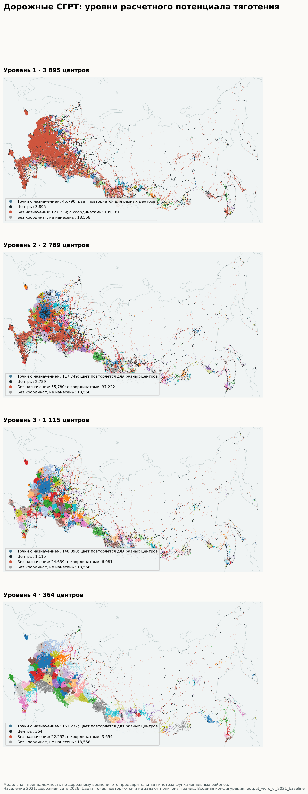
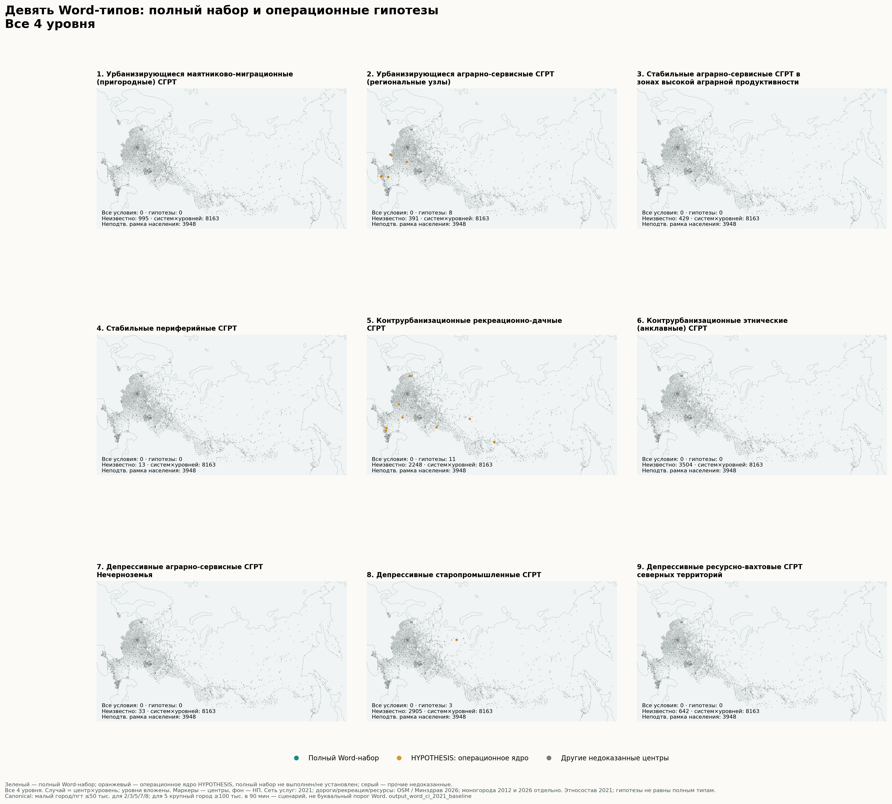

# Динамическая типология сельско-городских районов тяготения России

Вычислительная реализация концепции исходной рукописи. Материалы для научного обсуждения, 21 октября 2026 года.

## 1. Постановка задачи и статус результата

Единица исследования — центр и связанное с ним сельско-городское окружение, определяемое транспортной доступностью и собственной демографической, экономической и сервисной массой. Административная сетка используется для источникового контекста и независимой проверки, а не как готовая граница СГРТ.

Рассчитаны назначения, иерархия, раздельные сервисные сети и динамика центра, сельского окружения и всей системы. Исходная ось содержит 173 527 источниковых единиц, включая неполные временные цепочки; 154 969 имеют принятые координаты. Модель содержит 782 низовых систем с сельским окружением. Содержательные типы отделены от механических демографических сочетаний; недоказанные необходимые признаки остаются неизвестными.

Основная масса использует данные среза 2021 года; динамика 2010–2021 рассматривается в фиксированной аналитической сетке. Дороги характеризуют доступную картографическую сеть октября 2026 года и сценарные скорости. Такая конструкция допускает ретроспективное описание и анализ ассоциаций, но не является исторической реконструкцией транспортной сети 2010 года или причинным прогнозом.

Строгая независимая научная приёмка: Требуется дальнейшая источниковая и методическая доработка; полное соответствие концепции пока не принято. Отсутствие допуска нельзя заменить успешным выполнением программных проверок.

## 2. Информационная база и измеренные ограничения

| Блок | Фактический массив | Смысл и ограничение |
| --- | --- | --- |
| Переписная ось | 173 527 | Источниковые единицы и пропуски сохранены |
| Образование 2021 | 30 094 школьных записей | Явный адрес и географический кандидат раздельны |
| Медицина 2021 | 64 976 объектов | Подтипы и картографическая наблюдаемость разделены |
| Торговля/финансы/администрация 2021 | Датированный слой OSM | Количество записей не равно мощности |
| САТ >10°C FAO | 154 968 НП | Суточный показатель, норма 1981–2010 |
| Почвенные рейтинги FAO | 152 337 НП | Агрономические классы, отдельны от российского бонитета |
| Доля посевов/угодий 2021 | 84 субъекта | Совместимые региональные первоисточники, не муниципальные площади |
| Российский бонитет | 20 559 интервалов | Экспериментальное восстановление по мелкомасштабному атласу |

Наблюдения услуг получены из полных российских срезов OSM2021 и 2026 с сохранением исходных объектов, тегов, дат и правил связывания. Явно названное местоположение отделено от ближайшего пространственного кандидата. Ненаблюдаемость не кодируется как доказанное отсутствие услуги. Изменение картографических записей между датами не приравнивается к открытию или закрытию учреждений.

Качество демографии 2010 анализируется на окончательных модельных узлах. Сохранилось 118 244 защищённых вторичных значений с неподтверждённым точным охватом; подробная первичная ревизия и принятые замены приведены ниже.

Независимая проверка по официальному перечню 473 однозначно связанных НП с ФАП Удмуртии выявила лишь 27 НП с любым координатным медицинским свидетельством в OSM. Поэтому модель использует измеренную наблюдаемость сети, а полная функциональная обеспеченность не установлена. Муниципальные естественное движение, миграция и ввод жилья сохраняют муниципальное зерно и не становятся собственными показателями каждой деревни. Рождения, смерти и прирост согласованы, численные конфликты и неоднозначные исходные коды исключены.

## 2 а. Восстановленные первичные данные и новые контексты

В четырёх региональных переписных публикациях восстановлено и принято 18 909 однозначных связок НП 2010. Из них 18 727 ранее имели защищённые вторичные значения; 12 452 чисел изменены, 3 549 нулей отдельно выведены из исчерпывающих перечней, точных сумм и контрольных чисел безнаселённых НП. В данном финальном модельном файле применено 18 909 связок и 12 452 численных изменений. Исходные значения и первичные локаторы сохранены, ось не перезаписана.

Качество 2010 читается из окончательных model/nodes.parquet: 118 244 осевых единиц сохраняют статус защищённого вторичного значения с неподтверждённым точным охватом. Опубликованное число и доказанная переписная истинность остаются разными уровнями свидетельства. Нули, доказанные контролями, имеют собственный quality-класс.

| Регион | Принято НП | Численных изменений | Доказанных нулей |
| --- | --- | --- | --- |
| Башкортостан | 3 492 | 2 714 | 0 |
| Тверская область | 8 683 | 5 497 | 1 994 |
| Вологодская область | 4 200 | 2 538 | 1 089 |
| Новгородская область | 2 534 | 1 703 | 466 |

Современный аграрный контекст восстановлен из двух первоисточников: Росреестр, приложение 2 к докладу 2021, страницы 174–179, угодья всех категорий на 01.01.2022; Росстат, бюллетень посевных площадей 2021, лист T_1440, хозяйства всех категорий. Знаменатель покрывает 85 субъектов, совместимая доля — 84. Сумма угодий 221,907.1 тыс.га совпала с общероссийской контрольной суммой; посевы 80,383.367 тыс.га, отношение 36.22%. Это региональная посевная нагрузка, включающая в знаменатель сенокосы и пастбища: низкая доля не равна заброшенности. Санкт-Петербург остаётся NULL; повторяемые региональные значения не превращены в площади НП или СГРТ.

Дополнительно восстановлены 20 559 экспериментальных интервалов российского бонитета по атласной карте масштаба 1:30,000,000. Интервалы выделены только при устойчивом классе в пределах ошибки геопривязки; техническая неслепая проверка контрольных точек дала RMSE около 19.3 км. Это не независимая оценка точности геопривязки. Смешанные классы и экстраполяция вне опорных точек оставлены неизвестными. Это отдельная чувствительность, а не точечная кадастровая оценка и не замена FAO-рейтинга в основной спецификации.

## 3. Масса, дорожная доступность и иерархия

Базовая положительная масса строится экспоненцированием среднего стандартизированных компонентных блоков. В неё входят собственная людность, наблюдаемые образование, здравоохранение, торговля и финансы, регистрационный экономический прокси, муниципальные жильё и демографическое движение. Веса не обучаются на сельском населении, которое эта же масса сама притянула. Тем самым исходная круговая калибровка устранена.

Модель выбора использует Gij=Mj·exp(−Tij/τ), Pij=Gij/(ΣkGik+Moutside). Tij получено по направленному дорожному графу; соединительный внедорожный участок со скоростью 15 км/ч хранится отдельно. В основной конфигурации τ=30 минут, предел=180 минут, порог выбора=0.35, Moutside=0. При Moutside=0 вероятность условна на наблюдаемом наборе доступных поставщиков. Консервативный вариант с внешней альтернативой сохраняется отдельно. Параметры сценарные и не подбирались по точности на проверочных медицинских отношениях.

Центральность варианта WordCi задана формулой Ci=0,5·minmax(log Mi)+0,5·minmax(log(1+R2021)), где R2021 — предварительная сельская людность. Для основного Ci предварительная сельская людность берётся по наблюдаемому перечню переписи 2021. Исторические записи, не входящие в этот перечень, исключены только из данного R2021 и не превращены в нули; они сохранены в полной источниковой оси и отдельных агрегатах. Строгая полнота по всем историческим источниковым единицам сохранена только в диагностических колонках; полного альтернативного расчёта иерархии по такому Ci не выполнялось. Ранги варианта WordCi учитывают собственную массу Mi и объём предварительного сельского окружения в явной формуле центральности Ci. Сначала выполняется один предварительный выбор среди всех центров; известный сельский объём и UNKNOWN сохраняются отдельно. Затем рассчитываются Ci и монотонные ранги, после чего строится окончательная иерархия снизу вверх. Собственная Mi на притянутом населении не переобучается и остаётся гравитационным весом. Для родительской связи WordCi требуются больший Ci и старший монотонный порядок; меньшая собственная Mi у такого родителя допустима, поскольку в Ci включено предварительное сельское окружение. Предварительный и окончательный составы не смешиваются; исходный вариант рангов по собственной массе остаётся сравнительным сценарием. Статистические границы рангов берутся в точке пересечения взвешенных плотностей соседних компонент GMM между их средними; если пересечения нет, применяется явно заданная середина между средними. Они не объявляются наблюдаемыми ступенями обслуживания. Поскольку людность 2021 участвует в Mi и Ci, геометрия районов и ретроспективный демографический исход статистически связаны конструкцией; это дополнительное основание описательной, а не причинной интерпретации. В выбранном расчёте правило середины применено для 1 из 3 границ; остальные используют пересечение плотностей. В предварительном реестре: 155 411 единиц наблюдаемого перечня переписи 2021, включая 24 758 наблюдаемых нулей; неизвестных значений в этом перечне — 0. Компонента наблюдаемого перечня полна у 3 897 центров. В диагностических колонках требование полноты по всем историческим источниковым единицам выполняется у 3 729 центров; неполнота затрагивает 168 центров и 528 единиц в предварительно назначенных окружениях.

Раздельные функциональные сети позволяют расходиться образовательным, медицинским и интегральным назначениям. Негеолоцированные, недоступные и неопределённые единицы сохраняют собственные статусы. Несколько сопоставимых центров характеризуют модельный полицентрический потенциал; подтверждение реальных взаимодействий требует независимых потоков и данных о разделении функций.

| Уровень | Системы | С сельским окружением | Полное население 2010 |
| --- | --- | --- | --- |
| 1 | 3 895 | 782 | 3 466 |
| 2 | 2 789 | 1 096 | 2 282 |
| 3 | 1 115 | 788 | 758 |
| 4 | 364 | 275 | 222 |

Дополнительная нециркулярная административная калибровка выполнена на 55 полных единицах из 16 регионов, независимо связанных с центром источниковыми административными отношениями. Ошибка межрегиональной проверки log-населения: 1.424, базового среднего: 1.626. Это калибровка административного охвата, а не наблюдаемых поездок; текущие OSM-коды не доказывают историческую эквивалентность границ. Калиброванная масса автоматически основной не объявлена.

## 4. Динамика центра, села и системы

Для каждого уровня сохранены известные суммы, число неизвестных значений, реальные нули, собственное население центра и население внешнего сельского окружения. Изменение рассчитывается для численно полной пары наблюдений; полнота чисел сама по себе не доказывает историческую сопоставимость границ. Изменение состава территории и ошибка исторических связок остаются самостоятельным источником неопределённости.

На полной низовой подвыборке 386 систем центр и сельское окружение одновременно сокращаются в 289 случаях; центр растёт при сокращении окружения — в 53; центр сокращается при росте окружения — в 28. Это знаки совокупного изменения, без причинного объяснения миграцией или хозяйственной специализацией.

## 5. Девять содержательных типов исходной концепции

После буквального аудита исходной концепции широкие демографические прототипы (64 положительных сочетаний центр×уровень) сохранены отдельно. Основные названия и таблицы ниже относятся к канонической операционализации (22 положительных сочетаний у 14 уникальных центров). Проверяются тип центра, сценарная граница малых городов до 50 тыс.жителей, близость рекреационно-дачных систем к городу от 100 тыс.жителей и географическое свидетельство Нечерноземья. Неизвестный обязательный признак не превращается в положительный тип. Это адаптация определения типов при замороженных массах, рангах и составах районов.

Для рекреационно-дачного типа близость к крупному городу — явный дорожный сценарий, не установленный поведенческий порог. Основная граница 90 минут сопоставлена с 60/120/180 минутами; фактическое число канонических сочетаний центр×уровень типа 5 по сценариям: 60 мин — 5, 90 мин — 11, 120 мин — 14, 180 мин — 17. Классификационная центральность Ci заморожена до окончательного районирования; вычисленная по финальному окружению центральность остаётся только постфактум-диагностикой.

В таблице проверяется каждая пара центр×уровень: один центр может участвовать в системах разных уровней, которые нельзя сливать в одну строку. Числа описательных типов не образуют взаимоисключающего разбиения; пересечения и UNKNOWN сохранены. Расширенная AND-проверка содержит дополнительные иллюстративные признаки и механизмы и не отменяет описательную классификацию по измеренному ядру.

| Ур. | Тип исходной концепции | Расшир. AND | Описательные | UNKNOWN |
| --- | --- | --- | --- | --- |
| 1 | 1. Урбанизирующиеся маятниково-миграционные (пригородные) СГРТ | 0 | 0 | 425 |
| 1 | 2. Урбанизирующиеся аграрно-сервисные СГРТ (региональные узлы) | 0 | 4 | 230 |
| 1 | 3. Стабильные аграрно-сервисные СГРТ в зонах высокой аграрной продуктивности | 0 | 0 | 255 |
| 1 | 4. Стабильные периферийные СГРТ | 0 | 0 | 8 |
| 1 | 5. Контрурбанизационные рекреационно-дачные СГРТ | 0 | 5 | 1 348 |
| 1 | 6. Контрурбанизационные этнические (анклавные) СГРТ | 0 | 0 | 2 079 |
| 1 | 7. Депрессивные аграрно-сервисные СГРТ Нечерноземья | 0 | 0 | 18 |
| 1 | 8. Депрессивные старопромышленные СГРТ | 0 | 0 | 1 438 |
| 1 | 9. Депрессивные ресурсно-вахтовые СГРТ северных территорий | 0 | 0 | 259 |
| 2 | 1. Урбанизирующиеся маятниково-миграционные (пригородные) СГРТ | 0 | 0 | 320 |
| 2 | 2. Урбанизирующиеся аграрно-сервисные СГРТ (региональные узлы) | 0 | 4 | 136 |
| 2 | 3. Стабильные аграрно-сервисные СГРТ в зонах высокой аграрной продуктивности | 0 | 0 | 152 |
| 2 | 4. Стабильные периферийные СГРТ | 0 | 0 | 3 |
| 2 | 5. Контрурбанизационные рекреационно-дачные СГРТ | 0 | 4 | 680 |
| 2 | 6. Контрурбанизационные этнические (анклавные) СГРТ | 0 | 0 | 1 072 |
| 2 | 7. Депрессивные аграрно-сервисные СГРТ Нечерноземья | 0 | 0 | 9 |
| 2 | 8. Депрессивные старопромышленные СГРТ | 0 | 1 | 940 |
| 2 | 9. Депрессивные ресурсно-вахтовые СГРТ северных территорий | 0 | 0 | 173 |
| 3 | 1. Урбанизирующиеся маятниково-миграционные (пригородные) СГРТ | 0 | 0 | 133 |
| 3 | 2. Урбанизирующиеся аграрно-сервисные СГРТ (региональные узлы) | 0 | 0 | 19 |
| 3 | 3. Стабильные аграрно-сервисные СГРТ в зонах высокой аграрной продуктивности | 0 | 0 | 17 |
| 3 | 4. Стабильные периферийные СГРТ | 0 | 0 | 1 |
| 3 | 5. Контрурбанизационные рекреационно-дачные СГРТ | 0 | 1 | 167 |
| 3 | 6. Контрурбанизационные этнические (анклавные) СГРТ | 0 | 0 | 269 |
| 3 | 7. Депрессивные аграрно-сервисные СГРТ Нечерноземья | 0 | 0 | 3 |
| 3 | 8. Депрессивные старопромышленные СГРТ | 0 | 1 | 409 |
| 3 | 9. Депрессивные ресурсно-вахтовые СГРТ северных территорий | 0 | 0 | 129 |
| 4 | 1. Урбанизирующиеся маятниково-миграционные (пригородные) СГРТ | 0 | 0 | 117 |
| 4 | 2. Урбанизирующиеся аграрно-сервисные СГРТ (региональные узлы) | 0 | 0 | 6 |
| 4 | 3. Стабильные аграрно-сервисные СГРТ в зонах высокой аграрной продуктивности | 0 | 0 | 5 |
| 4 | 4. Стабильные периферийные СГРТ | 0 | 0 | 1 |
| 4 | 5. Контрурбанизационные рекреационно-дачные СГРТ | 0 | 1 | 53 |
| 4 | 6. Контрурбанизационные этнические (анклавные) СГРТ | 0 | 0 | 84 |
| 4 | 7. Депрессивные аграрно-сервисные СГРТ Нечерноземья | 0 | 0 | 3 |
| 4 | 8. Депрессивные старопромышленные СГРТ | 0 | 1 | 118 |
| 4 | 9. Депрессивные ресурсно-вахтовые СГРТ северных территорий | 0 | 0 | 81 |

В исходной рукописи определения типов соседствуют с формулировками «как правило», «нередко», «зачастую». Операциональное демографическое и функциональное ядро задаёт измеренные описательные исследовательские типы; расширенная TRUE/FALSE/UNKNOWN-матрица отдельно проверяет иллюстративные признаки и недоказанные механизмы. Нулевое число полностью выполненных расширенных AND-наборов не означает отсутствия выделенных типов. Маятниковая миграция не выводится из дорожной близости, вахтовость — из наличия шахты; механистические утверждения требуют отдельных данных.

## 5 а. Именные примеры выделенных описательных типов

Примеры выбираются из фактически рассчитанных положительных описательных типов каждого уровня, до трёх на сочетание. Темпы — среднегодовые изменения центра и сельского окружения; население всей СГРТ (центр и всё включённое окружение), а не только центра, показано известной суммой и читается вместе с флагами полноты. Таблица не устанавливает причин наблюдаемой динамики.

| Центр и регион | Ур. | Тип | Центр/год | Село/год | Население всей СГРТ:2010 → 2021 |
| --- | --- | --- | --- | --- | --- |
| Белинский (пензенская) | 1 | 2 | +0.10% | -0.84% | 11 794 → 11 599 |
| Грайворон (белгородская) | 1 | 2 | -0.08% | -0.96% | 15 885 → 14 859 |
| Ипатово (ставропольский) | 1 | 2 | +0.02% | -1.23% | 50 293 → 47 270 |
| Грайворон (белгородская) | 2 | 2 | -0.08% | -0.96% | 15 885 → 14 859 |
| Ипатово (ставропольский) | 2 | 2 | +0.02% | -1.23% | 50 293 → 47 270 |
| Мостовской (краснодарский) | 2 | 2 | +0.17% | -0.26% | 30 596 → 30 913 |
| Высокий (ханты мансийский югра) | 1 | 5 | -0.53% | +1.08% | 11 984 → 12 221 |
| Дружная Горка (ленинградская) | 1 | 5 | -0.05% | -0.18% | 4 584 → 4 543 |
| Зеленокумск (ставропольский) | 1 | 5 | -0.70% | -0.23% | 42 330 → 39 519 |
| Зеленокумск (ставропольский) | 2 | 5 | -0.70% | -0.23% | 42 330 → 39 519 |
| Моздок (северная осетия алания) | 2 | 5 | -0.48% | +0.35% | 82 877 → 82 603 |
| Рамонь (воронежская) | 2 | 5 | +0.16% | +1.14% | 15 938 → 17 091 |
| Березовка (красноярский) | 3 | 5 | -0.83% | +0.09% | 1 091 367 → 1 309 538 |
| Березовка (красноярский) | 4 | 5 | -0.83% | +0.06% | 1 091 537 → 1 309 608 |
| Инта (коми) | 2 | 8 | -4.09% | -6.86% | 33 585 → 20 887 |
| Инта (коми) | 3 | 8 | -4.09% | -6.86% | 33 585 → 20 887 |
| Инта (коми) | 4 | 8 | -4.09% | -6.86% | 33 585 → 20 887 |

## 5 б. Независимое функциональное свидетельство маятниковых связей

Махрова и Бочкарев (2017) публикуют результаты мобильных данных за ноябрь 2015: долю работающих в Москве среди всех выезжающих на работу из муниципалитета. В статье приведены следующие именные значения (PDF с.11); муниципальная карта показана на рис.7, PDF с.13. Это самостоятельная функциональная опора для исследования маятникового типа, с другим годом и муниципальным зерном. Муниципалитет не приравнивается к переписному НП, а проценты не являются долей всех жителей или занятых. Значения не перенесены на национальную сеть и автоматически не присваивают тип 1.

| Названная территория | Доля выезжающих, работающих в Москве | Период |
| --- | --- | --- |
| Буньковское сельское поселение | 9.9% | Ноябрь 2015 |
| Солнечногорск | 46.0% | Ноябрь 2015 |
| Монино | 36.4% | Ноябрь 2015 |
| Подольск | 68.6% | Ноябрь 2015 |

Железнодорожная таблица 2014 в той же статье относится к пассажирским поездкам, включая повторные поездки и иные цели; она сохранена отдельно и не смешивается с мобильным показателем 2015. Географические ID в реестре служат справочными связками, а не доказанным историческим соответствием границ муниципалитета и НП.

Независимое промышленное свидетельство: Инта, АО Интауголь, угледобыча, событие 2018. Муниципальный документ называет решение совета директоров о добровольной ликвидации 02.07.2018 и отсутствие добычи на 01.08.2020; нельзя считать дату решения последним днём добычи или исключать промежуточный запуск. Источник: Стратегия социально-экономического развития Инты до 2035, утверждена решением Совета 25.12.2020 №IV-4/1; Раздел 1.1.3 Характеристика экономики МОГО Инта, подраздел Промышленное производство; абзацы после перечисления специализаций; https://base.garant.ru/400135706/. Это свидетельство отдельного производства, без автоматического вывода о хозяйственном крахе всей СГРТ.

Независимое промышленное свидетельство: Верхний Уфалей, ОАО Уфалейникель, никелевая металлургия, событие 2017. Справочник фиксирует остановку 2017 и распродажу имущества в ходе банкротства 2019; следующим абзацем прямо локализует комбинат в городе Верхний Уфалей. Источник: ИТС 12-2019 Производство никеля и кобальта; Раздел 2.2 Технологии производства никеля из окисленных руд; абзацы после Южуралникеля и перед перечислением местоположений трёх заводов; https://meganorm.ru/mega_doc/norm/zaklyuchenie/0/its_12-2019_informatsionno-tekhnicheskiy_spravochnik_po.html. Это свидетельство отдельного производства, без автоматического вывода о хозяйственном крахе всей СГРТ.

Независимое промышленное свидетельство: Реж, ЗАО ПО Режникель; Режский никелевый завод, никелевая металлургия, производство никелевого штейна, событие 2017. Справочник отдельно подтверждает остановку Режского завода 2017 и точный город; при этом текст сам допускает потенциальный перезапуск мощностей, поэтому вечное закрытие не приписывается. Источник: ИТС 12-2019 Производство никеля и кобальта; Раздел 2.2 Технологии производства никеля из окисленных руд; сразу после абзаца об Уфалейникеле, перед точным местоположением Режского завода в г. Реже; https://meganorm.ru/mega_doc/norm/zaklyuchenie/0/its_12-2019_informatsionno-tekhnicheskiy_spravochnik_po.html. Это свидетельство отдельного производства, без автоматического вывода о хозяйственном крахе всей СГРТ.

## 6. Независимая проверка модельных назначений

Официальные территории первичной медицинской помощи Ленинградской области 2024 дают 222 уникальных внешних отношений с явно связанным поставщиком. Точное совпадение низового назначения на всех таких парах: 4.1%; среди пар с поставщиком в наборе модельных кандидатов: 28.1%. Доля источниковых поставщиков, попавших в набор кандидатов, оценивается отдельно от точности назначения. Нормативное прикрепление не является наблюдаемой поездкой и не служит универсальной истиной для всех услуг. Этот корпус не используется для обучения и не назван слепой заранее зарегистрированной проверкой.

## 6 а. Покрытие медицинских поставщиков и независимый ориентир

| Проверка | Числитель | Пар | Доля |
| --- | --- | --- | --- |
| Поставщик наблюдается в OSM2021 | 12 | 222 | 5.4% |
| Медицинский лидер до порога | 12 | 222 | 5.4% |
| Ближайший по дорожной сети поставщик | 12 | 222 | 5.4% |
| Медицинское назначение после порога | 3 | 222 | 1.4% |
| Интегральное низовое назначение | 9 | 222 | 4.1% |

Главное ограничение этой проверки — слабая наблюдаемость поставщиков в датированном слое 2021 и несовпадение дат с нормативным прикреплением 2024. Совпадение среди наблюдаемых поставщиков и совпадение по всем исходным парам имеют разные знаменатели. Ближайший дорожный поставщик служит независимым простым ориентиром; превышение качества над ним не предполагается заранее. Нормативное прикрепление не является наблюдаемой поездкой. Низкие показатели не скрыты и не выданы за подтверждённую точность национальной сети.

После ограничения на наблюдаемых поставщиков: 3 совпадений из 12; по всем исходным внешним отношениям: 3 из 222. Ограниченная подвыборка не заменяет общий результат.

Для интегрального назначения среди источниковых поставщиков, попавших в кандидатный набор: 9 из 32. Это отдельный тест многозадачной интегральной модели, а не замена теста специализированной медицинской сети.

## 6 б. Новый корпус 2021 после замораживания модели

Прямо получен официальный акт Правительства Калужской области от 30.07.2021 №493, публикация 4000202108050001: 374 страницы, таблица прикрепления на PDF с.29–94. Все 642 строки сохранены, включая неоднозначные и неразрешённые. Источниковый протокол дополнен явной поправкой класса источника: официальный региональный правительственный/правовой портал допущен наряду с Минздравом/ТФОМС. Поправка внесена после получения и осмотра документа, до связывания ID и сравнений; исходный протокол неизменён. Это новое испытание после замораживания модели, а не первоначально слепой эксперимент.

Независимо визуально сверены 40 строки с разрешённым местом поставщика на 27 страницах PDF; остальные 602 строки не прошли эту независимую визуальную сверку и не имеют принятых связок поставщика; отрицательный вывод на весь документ не переносится. Исключены 30 домохозяйственных записей; оставшиеся 10 реальных записей поставщиков локальны. Во всей рассмотренной подвыборке 36 пар имеют одинаковые origin/destination, 3 происхождения не разрешены, 1 запись содержит конфликт типа НП. Принятых межпоселенческих сопоставимых пар — 0. Поэтому метрика точности назначений не рассчитывается: это непригодность полученной подвыборки для проверки межпоселенческой геометрии, а не 0% точности и не доказательство успешности модели. Модель и параметры не подгонялись.

Первоисточник: http://publication.pravo.gov.ru/file/pdf?eoNumber=4000202108050001; SHA256 4fd94192431472a9c96db5e47df39f0670aef91234ca2dfba50e6fafeb519637. Протокол, поправка класса источника, полный реестр и независимая рецензия доступны в validation/holdout2021_*.

Отдельная проверка наблюдаемости: 10 реальных записей соответствуют 9 уникальным НП. Положительное медицинское свидетельство в замороженном слое OSM2021 есть у 2; у 7 положительное свидетельство отсутствует. Эта непредставительная подвыборка показывает наблюдаемость присутствия на уровне НП, не национальную полноту, совпадение конкретного учреждения, мощность, прикрепление или поездки. Отсутствие свидетельства не означает отсутствия учреждения.

Последующий поиск адресов в том же акте дал 39 дополнительных кандидатных связок сверх исходного реестра. Они ещё не приняты независимой проверкой и не меняют вывод по исходной проверенной подвыборке 40 строк. Кандидатный адрес не доказывает прикрепление, функционирование учреждения или точность модели.

## 7. Проверка гипотез и границы интерпретации

Межрегиональная перекрёстная проверка переоценивает регрессию и масштабирование признаков на обучающих регионах. Исходные массы, ранги Ci и составы районов остаются фиксированными результатами общероссийского расчёта. Полная вложенная проверка всего алгоритма на регионах, не участвовавших в построении сетки, здесь не заявляется; участие людности 2021 в Mi/Ci сохраняет конструктивную зависимость от ретроспективного исхода.

М 1, М 2 и М 3 сравниваются на одной и той же полной подвыборке: сначала масса и доступность, затем сельский аграрный и природный контекст, затем конфигурация и пригородность. Стандартизация выполняется внутри обучающей части, регионы разделяют обучение и проверку. Совместимая региональная доля посевов 2021 и экспериментальные интервалы бонитета вынесены в отдельные сценарии; основной дизайн М 1–М 3 сохраняет первоначальный набор признаков. Отбор полной подвыборки и пространственная зависимость остатков проверяются отдельно.

Атлас содержит исходное покрытие, климат и почвы, вложенную иерархию, содержательные типы-гипотезы и фактические дорожные изохроны. Точки населённых пунктов и сеть не изображаются доказанными непрерывными территориальными полигонами. Для основного варианта и варианта с географическими кандидатами сохраняется отдельный состав, чтобы масштаб неопределённости связывания был видим.

## 7 а. Фактически рассчитанное сравнение моделей

| Уровень | Модель | Общая N | Регионов | RMSE по новым регионам | MAE |
| --- | --- | --- | --- | --- | --- |
| 1 | M1 | 144 | 23 | 9.927 | 7.433 |
| 1 | M2 | 144 | 23 | 10.030 | 7.544 |
| 1 | M3 | 144 | 23 | 10.613 | 7.935 |
| 2 | M1 | 183 | 25 | 9.448 | 7.198 |
| 2 | M2 | 183 | 25 | 9.425 | 7.172 |
| 2 | M3 | 183 | 25 | 9.307 | 7.112 |

Ошибки относятся к совокупному процентному изменению 2010–2021, а не к ежегодным процентам. Общая выборка и совпадающие региональные разбиения сохранены для всех трёх спецификаций. Масса 2021 включает население конечного года и потому механически связана с исходом; даже контроль исходного населения и отдельный сельский исход не устраняют эндогенность. Коэффициенты и интервалы имеют описательный смысл.

Проверка только на полностью первично подтверждённых переписных значениях: уровень 1: N=4, регионов=2, INSUFFICIENT_COMMON_SAMPLE_OR_REGIONS; уровень 2: N=3, регионов=1, INSUFFICIENT_COMMON_SAMPLE_OR_REGIONS; уровень 3: N=2, регионов=1, INSUFFICIENT_COMMON_SAMPLE_OR_REGIONS; уровень 4: N=0, регионов=0, INSUFFICIENT_COMMON_SAMPLE_OR_REGIONS.

## 7 б. Чувствительность собственной массы

Исходная формула массы независимо воспроизведена. При фиксированных кандидатах поочерёдно исключён каждый из пяти блоков; корреляция относится к порядку масс, Jaccard — к пересечению верхнего дециля. Районы тяготения и иерархия в этом тесте повторно не рассчитывались; проверка не измеряет точность притяжения.

| Исключён блок | Кандидатов | Spearman порядка масс | Jaccard верхнего дециля |
| --- | --- | --- | --- |
| Собственная людность | 3 897 | 0.982 | 0.879 |
| Демографический контекст | 3 897 | 0.959 | 0.688 |
| Экономический прокси | 3 897 | 0.858 | 0.579 |
| Жильё | 3 897 | 0.955 | 0.653 |
| Сервисы | 3 897 | 0.958 | 0.691 |

На уровне 1 ошибка M3 на отложенных регионах выше ошибки M1 на 0.685 процентного пункта. Это фактическое сравнение на общей полной выборке; изменение ошибки не доказывает причинную роль новых переменных.

На уровне 2 ошибка M3 на отложенных регионах ниже ошибки M1 на 0.141 процентного пункта. Это фактическое сравнение на общей полной выборке; изменение ошибки не доказывает причинную роль новых переменных.

## 7 в. Фактически пересчитанная чувствительность районов

Каждый перечисленный сценарий рассчитан целиком. Покрытие учитывает исходную ось, а людность — известную сумму 2021, без превращения неизвестных значений в нули. Сравниваются низший и высший доступный уровни; одинаковый номер уровня сам по себе не доказывает одинаковую функциональную ступень, а разные высшие порядки не гомологичны.

| Сценарий | Ур. | Назначено НП | Без назначения | Известная P2021 назначенных |
| --- | --- | --- | --- | --- |
| word_ci_2021_baseline | 1 | 45 788 | 127 733 | 104 079 579 |
| word_ci_2021_baseline | 4 | 151 275 | 22 246 | 127 101 548 |
| word_ci_2021_inclusive | 1 | 34 250 | 139 271 | 107 269 614 |
| word_ci_2021_inclusive | 5 | 151 866 | 21 655 | 127 393 682 |
| word_ci_2021_p0_sensitivity | 1 | 149 024 | 24 497 | 126 810 059 |
| word_ci_2021_p0_sensitivity | 4 | 152 438 | 21 083 | 127 612 543 |

| Направление A → B | Уровни A→B | Оба назначены | Тот же центр | Jaccard A→B |
| --- | --- | --- | --- | --- |
| word_ci_2021_baseline → word_ci_2021_inclusive | Низший 1→1 | 21 693 | 52.5% | 0.313 |
| word_ci_2021_baseline → word_ci_2021_inclusive | Высший 4→5 | 150 409 | 65.5% | 0.567 |
| word_ci_2021_baseline → word_ci_2021_p0_sensitivity | Низший 1→1 | 45 788 | 100.0% | 0.681 |
| word_ci_2021_baseline → word_ci_2021_p0_sensitivity | Высший 4→4 | 151 275 | 86.1% | 0.755 |

На низшем уровне доля совпадающих центров среди назначенных в обоих сценариях составляет 52.5–100.0%; направленное совпадение состава районов по лучшему Jaccard — 0.313–0.681. Это измеренная чувствительность границ к выбору сценария, а не внешняя проверка правильности районов. Jaccard сопоставляет каждый район A с наиболее похожим районом B и взвешивает по размеру A; обратное направление может дать другой результат. Смена неназначенного статуса не входит в знаменатель совпадения центров и показана отдельно в исходной таблице.

Основание типовых сравнений: word_ci_2021_baseline — каноническая операционализация, word_ci_2021_inclusive — каноническая операционализация, word_ci_2021_p0_sensitivity — каноническая операционализация. Сравнения с различающимися основаниями типов читаются как дополнительная чувствительность определения, а не как тождественная классификация.

| Сценарии A → B | Срез | Типы A / B | Сохранились | Только A / B |
| --- | --- | --- | --- | --- |
| word_ci_2021_baseline → word_ci_2021_inclusive | lowest | 9 / 1 | 0 | 9 / 1 |
| word_ci_2021_baseline → word_ci_2021_inclusive | highest | 2 / 1 | 1 | 1 / 0 |
| word_ci_2021_baseline → word_ci_2021_p0_sensitivity | lowest | 9 / 20 | 4 | 5 / 16 |
| word_ci_2021_baseline → word_ci_2021_p0_sensitivity | highest | 2 / 2 | 2 | 0 / 0 |

Канонические типы и широкие прототипы различены по сценариям в предыдущей подписи. Совпадение классификации у того же центра отражает устойчивость описательной гипотезы; оно не доказывает тождество изменившихся составов СГРТ.

## 8. Воспроизводимость и литературная опора

Все слои привязаны к устойчивым идентификаторам и снабжены датами, URL, SHA256, исходным зерном, единицами и правилами пропусков. Проверяющий агент независимо контролирует соответствие исходной рукописи; отказ по критерию возвращает расчёт на исправление. Программный цикл сохраняет команды, журналы и состояние приёмки. Прохождение технических проверок не объявляется научным завершением.

Методическая интерпретация опирается на выборочное первичное чтение Поляна, Трейвиша, Родомана, Покшишевского, Лаппо и Хорева, дополненное первичными текстами Баранского 1946, Колосовского 1947 и архивными выступлениями Маергойза в публикации 2012. Перечень прочитанных страниц и ограничения чтения сохранены в литературной матрице; чужим авторам не приписываются наши сценарные пороги.

Проверяемые выходы: model/*/memberships.parquet, systems.parquet, hierarchy.parquet, function_specific_memberships.parquet, word_type_hypotheses.parquet, operational_type_candidates.parquet; analysis/; maps/; transport/; reviews/. Требования и научные ограничения читаются вместе с картами.

Независимая матрица операционализации сверяет 32 точных фрагмента исходного Word (строки 65–96) и разделяет определяющее ядро, необходимую для утверждений о потоках функциональную опору, поддерживающие признаки, иллюстрации и механизмы. Полная таблица с буквальными цитатами: reviews/word_core_typology_operationalization.csv; это основание различия описательных типов и расширенного AND-профиля.

Функциональные типы опираются на разновременные признаки: демография 2010–2021 сопоставляется, в частности, с рекреационными свидетельствами и дорогами 2026. Поэтому они не объявляются исторически доказанной функцией территории именно в 2021 году.

Для этнического (анклавного) типа ответы переписи о национальной принадлежности отражают самоописание населения. Они не являются измерением языка, языковой преемственности или индивидуального поведения. Для типа 7 температурныйпорог сам по себе не устанавливает принадлежность к Нечерноземью; для типа 9 ресурсныйобъект сам по себе не устанавливает вахтовую функцию.

## 9. Проверяемые литературные и статистические источники

Литература ниже задаёт основания анализа связей, иерархии и функций. Она не объявляется эмпирическим доказательством наших порогов, сервисных мощностей или причин динамики.

1. Полян П. М. (2014). Территориальные структуры — урбанизация — расселение: теоретические подходы и методы изучения. Прочитано: Печатные 203–207; PDF 103–105 (новая версия 395 PDF-страниц). https://imwerden.de/pdf/polyan_territorialnye_struktury_2014.pdf

2. Полян П. М. (2014). Опорный каркас расселения региона: масштабная специфика и параметризация (глава сборника). Прочитано: Печатные 240–243; PDF 122–123; PDF 122 дополнительно просмотрена как изображение. https://imwerden.de/pdf/polyan_territorialnye_struktury_2014.pdf

3. Полян П. М. с И. Н. Заславским и Н. И. Наймарком (2014). Методика выделения городских агломераций (глава сборника). Прочитано: PDF 175–176; фрагменты о недостатке критериев реального взаимодействия и общесетевых методиках. https://imwerden.de/pdf/polyan_territorialnye_struktury_2014.pdf

4. Трейвиш А. И. (2006). Географическая полимасштабность в развитии России // География. № 11. Прочитано: Раздел «Принцип полимасштабности», абзацы о масштабе карты, ранге объектов и микро-/мезо-/макроуровнях. https://geo.1sept.ru/article.php?ID=200601102

5. Родоман Б. Б. (2021). «Поляризованный ландшафт»: полвека спустя // Известия РАН. Серия географическая. 85(3):467–480. Прочитано: Разделы «Введение» и «Транспорт и расселение в поляризованном ландшафте»; рис. 3. https://sciencejournals.ru/view-article/?a=IzvGeo2103012Rodoman&j=izvgeo&n=3&v=85&y=2021

6. Покшишевский В. В. (1978). Население и география: теоретические очерки. М.: Мысль. Прочитано: Печатные 106–108 (PDF 107–109) и 120–123 (PDF 121–124). https://www.demoscope.ru/weekly/knigi/IDEM_library/pdf/book044.pdf

7. Лаппо Г. М. (2005). Почему в XX веке в России создавались новые города // География. № 6. Прочитано: Разделы «Молодые города — старые центры» и о возникновении городов при формировании инфраструктуры; абзац «Транспортные магистрали выступили осями урбанизации». https://geo.1sept.ru/article.php?ID=200500603

8. Хорев Б. С. (1980; перепечатка 2022). Роль маятниковой миграции во взаимосвязи городского и сельского расселения и основные задачи её регулирования // Проблемы расселения в СССР. С. 222–234. Прочитано: Глава 11; начальные абзацы о трудовых/учебных поездках и специальных обследованиях; абзацы о недельных циклах. https://www.demoscope.ru/weekly/2022/0949/nauka03.php

9. Баранский Н.Н. (1946). Об экономико-географическом изучении городов. Печатные страницы 19,21–22,36,61–62; выборочное чтение первоисточника/авторской архивной записи, вся книга не заявлена прочитанной. https://elib.rgo.ru/handle/123456789/219639

10. Маергойз И.М. (2012). Географы должны внести свою лепту в выяснение путей развития как больших, так и малых городов. Печатные страницы 261–262; выборочное чтение первоисточника/авторской архивной записи, вся книга не заявлена прочитанной. https://djvu.online/file/2Xi5bPocoGQA6

11. Маергойз И.М. (2012). Мы изучаем территориальную субстанцию и функционирование народного хозяйства. Печатные страницы 263–266; выборочное чтение первоисточника/авторской архивной записи, вся книга не заявлена прочитанной. https://djvu.online/file/2Xi5bPocoGQA6

12. Колосовский Н.Н. (1947). Производственно-территориальное сочетание (комплекс) в советской экономической географии. Печатные страницы 133,137,142,152; выборочное чтение первоисточника/авторской архивной записи, вся книга не заявлена прочитанной. https://elib.rgo.ru/handle/123456789/218237

13. Махрова А.Г., Бочкарев А.Н. (2017). Маятниковая миграция в Московском регионе: новые данные. Демоскоп Weekly №727–728, 1–21 мая 2017. PDF с.4: методика; с.6: ноябрь 2015; с.11: четыре именных доли; с.13, рис.7: муниципальная карта. http://demoscope.ru/weekly/2017/0727/demoscope727.pdf

Росреестр. Государственный национальный доклад 2021: приложение 2, PDF174–179, колонки 3–5. SHA25646b0e2c130645bcb2aee50ffccc315e735a806977123e9d5b75434e9130c8a08. Архивный URL и точные строки сохранены в land2021_recovery/regional_farmland2021_primary.parquet.

Росстат. Посевные площади РФ в 2021 году. Бюллетень,06.03.2023; XLS лист T_1440, колонка 6, региональная строка. https://rosstat.gov.ru/storage/mediabank/posev_2021.xls. SHA2569648c0144304d884085dfdfcad68648844cc6bfe631621d35ae4ac30c68b3c38.

Национальный атлас почв РФ. Бонитет почвенного покрова, разворот 240–241. https://soil-db.ru/soilatlas/razdel-6-funkcii-pochv/bonitet-pochvennogo-pokrova. Изображение https://files.soil-db.ru/soilatlas/3600x2400/240-241-min.jpg. Геопривязка и интервальное извлечение экспериментальны.
