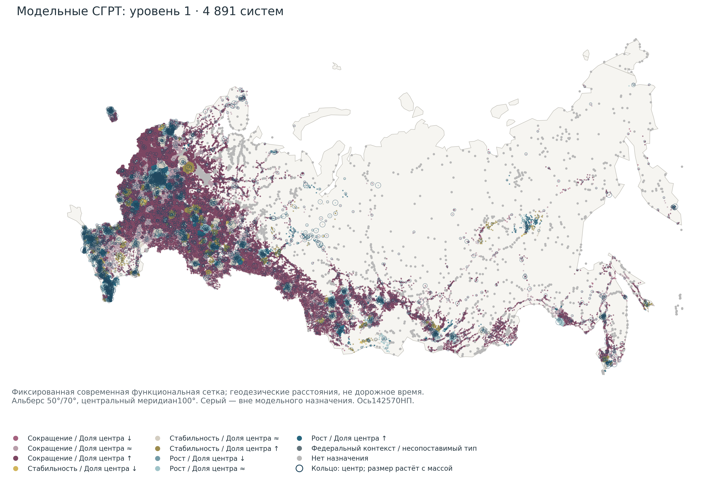
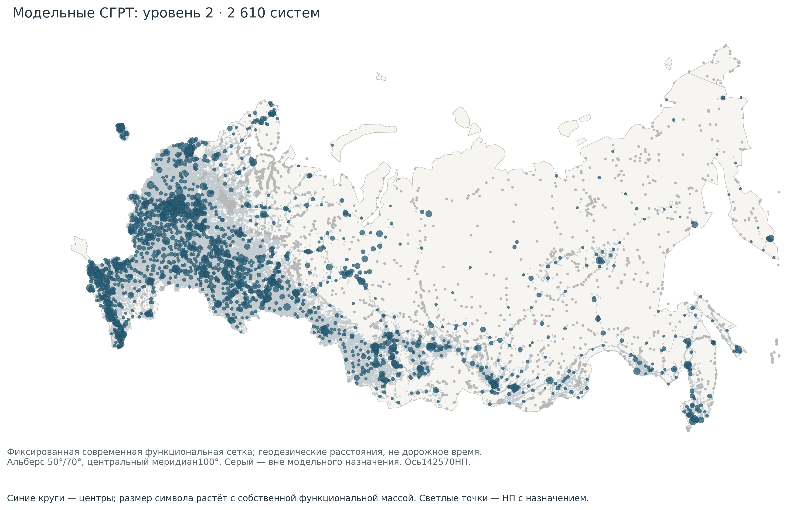
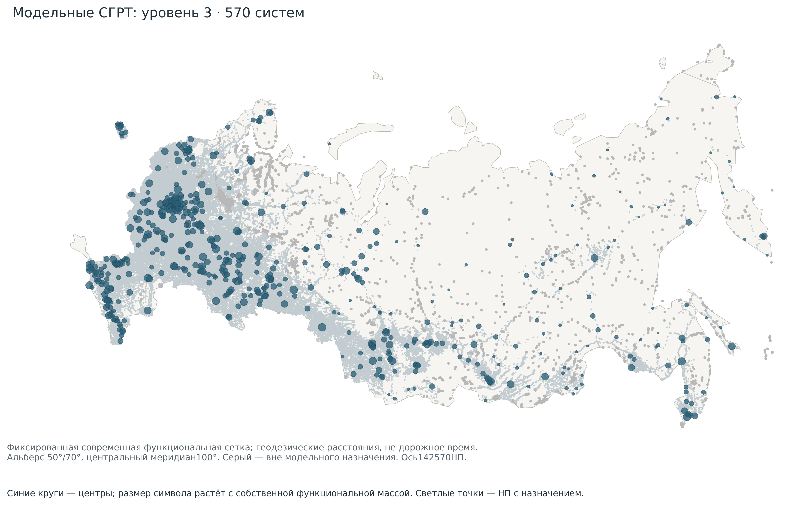
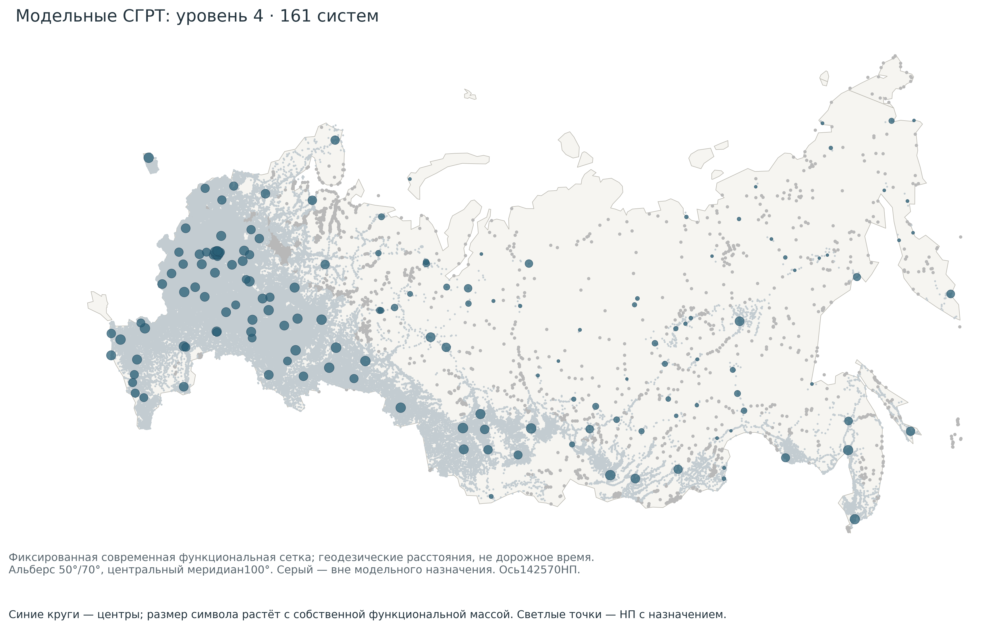
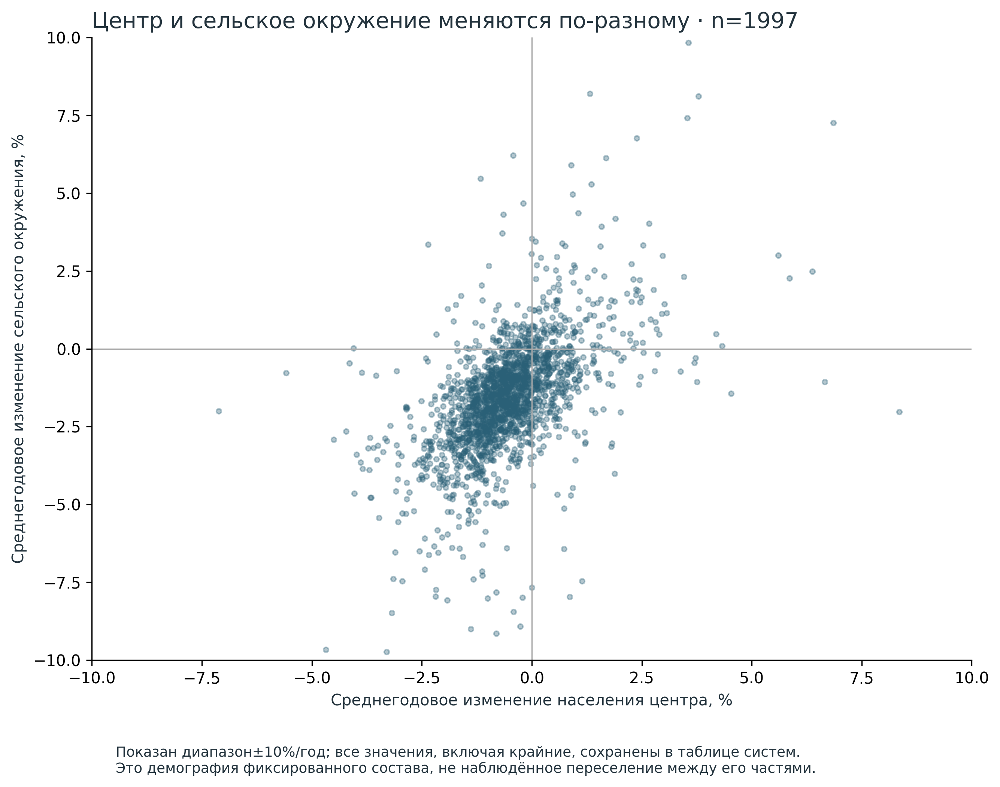
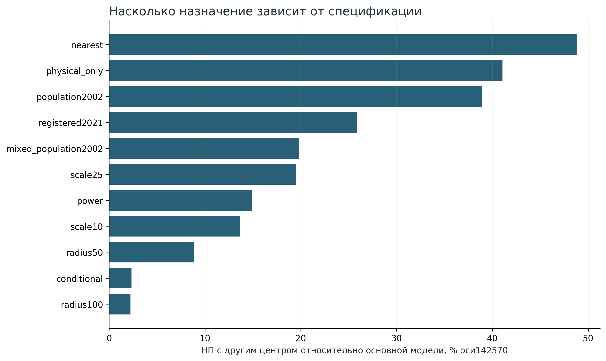
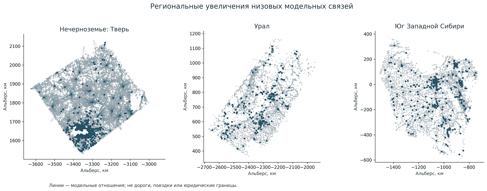
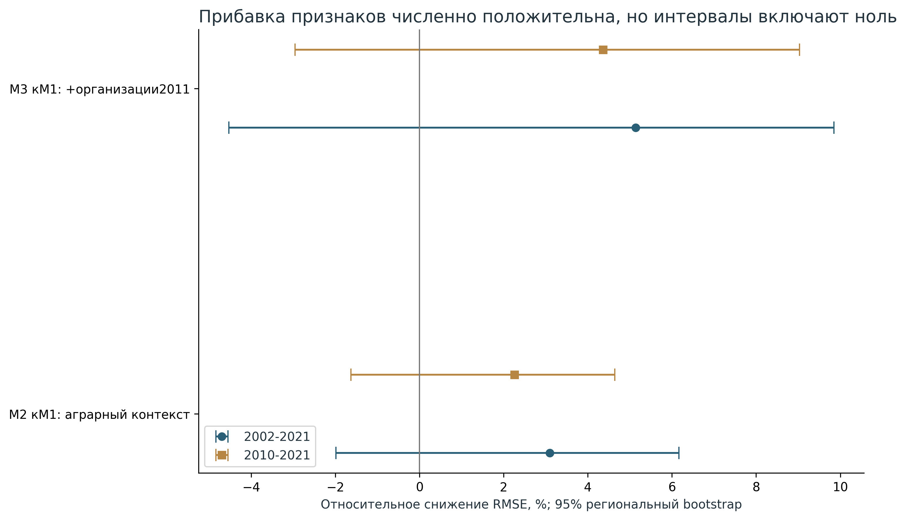

# Динамическая типология сельско-городских районов потенциального тяготения России

Предварительный национальный проход по исходной концепции Word ·21 октября 2026. Материал для обсуждения с научным руководителем.

## Что получено и что уже можно обсуждать

Рассчитана многоуровневая система на фиксированной оси 142 570 населённых пунктов. В основной функциональной спецификации модельное назначение получили 139 287 НП;3283 остались вне радиуса доступных кандидатов. На четырёх ступенях получены 4891,2610,570 и 161 система. Из низовых систем 2006 имеют внешнее сельское окружение и обычный сопоставимый центр; именно они образуют основную демографическую типологию. Это национальный вычислительный результат, но не подтверждённая сеть реального обслуживания.

В 1032 из 2006 сельских систем (51.4%) сокращение общего населения 2002–2021 сочетается с увеличением доли центра. Такое сочетание описывает концентрацию на фоне сжатия. Оно само по себе не устанавливает переезд жителей из окружения в центр.

Ключевой отрицательный результат: основная модель плохо воспроизводит доступные нормативные школьные связи —2 совпадения из 98 датированных утверждений для многопрофильного центра и 0 для отдельного образовательного назначения. Среди 16 известных поставщиков в модельных кандидатах присутствуют лишь 3. Вариант пока нельзя использовать как готовые границы реального обслуживания или основу адресного распределения господдержки. Возможные причины: неполнота сельских функций, различия уровней услуг и дат, расстояние вместо дорожного времени, а также сама спецификация массы.

Дополнительно построена близкая исходной постановке Word демографическая альтернатива: 6094 потенциальных обычных центров, 3520 низовых систем с сельским окружением; уровни 6094 / 3131 / 737 / 211. Крупнейшие поселения муниципалитетов явно помечены provisional; они не объявляются доказанными райцентрами. Альтернатива показывает цену исходных предположений, не заменяет функциональную проверку.

## 1. Исследовательский вопрос и связь с исходным Word

Исследование проверяет, как конфигурация системы «центр—окружение», её положение и доступные функциональные, экономические и аграрные признаки соотносятся с демографической устойчивостью. Сохраняются многоуровневое районирование снизу вверх, отдельная демография частей системы, функциональная неоднородность, сравнениеМ1/М2/М3 и картографическая типология. Пригородность/полицентричность и девять содержательных типов Word пока остаются проверяемыми гипотезами: близкие модельные веса не доказывают реальные потоки, а знак демографической динамики не доказывает этнический, дачный или вахтовый характер.

Круговая калибровка устранена: собственная масса центра вычисляется до назначения окружения; полученный моделью размер района не используется ни для обучения массы, ни для её ранга. Основная масса состоит из 11 групп функций, без населения и демографического исхода. Это явное изменение Word. В отдельных сценариях возвращены независимая людность 2002 и смешанная масса, чтобы проверить влияние этого решения.

## 2. Источники, ось и наблюдаемость

Побайтно восстановлен master142 570×914, SHA2568c98d5a113eec4c3bf131232b1d7e5c6362dc3a50ee484e964420de58c377f85. Суммы обычной оси 2002/2010/2021:127397236 /124684805 /125132003 человек. Это знаменатели выбранной сопоставляемой оси, не население всей РФ. Все 21 246 явных нулей 2010 сохранены; качество промежуточных чисел и доля защищённых наблюдений доступны по каждой системе. Москва и Санкт-Петербург — отдельные контекстные территориальные узлы, не добавленные повторно к обычным НП.

| Слой | Фактически доступно | Граница интерпретации |
| --- | --- | --- |
| Организации RFSD | 15лет2011–2025; собственные коды НП | Юрлица, не филиалы/занятые/реальные поездки |
| Школы | 7267 strictPOI в397НП;386НП от10тыс. жителей | Крайне неполная сельская сеть; нет полной мощности |
| Медицина | CoarsePlaces385НП; с документным пилотом433НП | Нет полного национального разделения ФАП/стационаров |
| WB21октября | 91043 исходных записи;74763 baseline;16172НП | Не все типы — ПВЗ; версии каталога не равны открытиям |
| WBтипы8/34 | 7991НП; базовая масса закреплена на19октября | Снимки разделены; свежий вариант — чувствительность |
| Аграрный контекст | Муниципальные площади/профили/производство | Повторённые поНП гектары не суммируются |
| 1989 | 19863 известных значения в исходной оси | Частичный разнородный исторический слой |

Официальный справочник подразделений ФРМО найден по описанию, но архив с физическими адресами и мощностями получить не удалось:503/502/403 и тайм-ауты задокументированы. Национальные образовательные порталы и ограниченные Overpass-попытки также не дали новых массовых строк. Это предел получения в данном проходе, не доказательство отсутствия данных. Полный Ozon-каталог не получен; медицинские центры «ДокторОЗОН» не превращены вПВЗ.

## 3. Модельный эксперимент и иерархия

Внутри каждой функции источниковые счётчики объединяются максимумом, затемlog(1+n), с ограничением верхнего 1% только в индексе. Масса—сумма 11 преобразованных компонент с заранее равными весами. Такой индекс измеряет модельную представленность функций; не мощность, качество или незаменимость обслуживания. Кандидат имеет≥2 наблюдаемые группы либо физическую школу/больницу. Все кандидаты сохраняют собственное ядро по конструктивному правилу.

Низовой потенциал Gij=Mj×exp(−dij/15 км); рассматриваются все кандидаты в 75 км без приближения ближайшими 64. Шаги иерархии используют 50/90/98 квантили собственной массы и радиусы 100/200/400 км. Системы объединяются целиком; для каждой ступени все три суммы населения сохранены. Квантили—сценарные ранги, не доказанные уровни специализированной помощи. Дорожная матрица и изохроны не построены: используется корректное сферическое расстояние и сохраняется неопределённость барьеров.

Из 4890 обычных ядер 2880 не имеют внешнего обычногоНП. У 2795 ядер свободная гравитационная модель выбрала бы другой центр; собственный состав сохранён принудительно. Поэтому число 4891 включает одиночные контейнеры и контекстный узел, а не 4891 доказанныйСГРТ. Результат чувствителен к правилу ядра; модельная неоднозначность и свободный победитель сохранены отдельно.

## 4. Демографические траектории

Население центра, всего внешнего окружения, сельского окружения и системы рассчитано для 2002/2010/2021 на одном современном фиксированном составе. Это ретроспективный аналитический разрез: не утверждается, что нынешние функции и границы существовали в 2002. Три класса темпа системы(±0,25%/год) и три класса изменения доли центра(±2 п.п.) дают девять демографических сочетаний; соседние пороги проверены отдельно.

Для 1989 выполнено сравнение на одном и том же наборе известных НП, с долей их населения 2002 в системе. Неизвестные значения не превращены в нули; национальная историческая полнота и сопоставимость границ не объявляются. Дистанционные градиенты вычислены для периферийных сельскихНП; они описывают ассоциации с расстоянием, не транспортную причинность.

## 5. Устойчивость, альтернативы и временная структура

По всей оси проверены 11 альтернатив: радиусы 50/100 км, масштабы затухания 10/25 км, степенная модель, ближайший центр, условные связки, только физические источники, только регистрационная масса 2021 и варианты с P2002. Это сценарная неопределённость, не доверительный интервал истинной границы. Только 21 265 НП сохраняют один и тот же центр во всех 11 различающихся сценариях; критерий строгий и включает принципиально другие наборы источников.

Отдельное обновление WB19→21 октября изменило 6 назначений в сопоставлении только обычных центров. Временная организационная история сохранена за все 15 лет; модели по юридическим массам 2011/2016/2021/2025 показывают чувствительность сетки к наблюдаемым регистрациям. Смены юридических записей и кодов не названы закрытиями услуг или реальным перехватом функций.

Документная медицина:49 записей 2025/2026, в двух обследованных сетях 19 подразделений с работником в обоих срезах; прикреплённое население 6422→6286. Это небольшой сопоставимый пример, не национальная динамика. Образование:98 внешних нормативных утверждений,74 исходныхНП,16 поставщиков; сохранены конкретные смены назначения, включаяНовуюТуру/Платину. Это проверки после разработки, не слепая отложенная выборка.

## 6. Аграрная среда и сравнениеМ1/М2/М3

Для каждого низового района построено двустороннее соответствие с муниципальной сеткой по населению 2002.603 пересечения проходят≥80% с обеих сторон; после требований к сельской периферии и полным ранним признакам в регрессиях остаются 304 системы 48 регионов. Гектары и выпуск сохраняют муниципальный смысл; источники не разрезаются пропорционально населению деревень. Этот отбор ограничивает обобщение.

М1: размер центра/сельского окружения 2002, доля центра и среднее расстояние. М2 добавляет муниципальные площади и производство 2010. М3 добавляет регистрационные свидетельства организаций 2011. Все модели сравниваются на одинаковых 304 строках; стандартизация обучается внутри пяти разнесённых по регионам блоков. Использован заранее фиксированный Ridgeα=1. Сетка современная, муниципальная принадлежность по справочнику 2021 и RFSD ретроспективного выпуска: причинный эффект и независимый исторический прогноз не установлены.

| Период | Модель | N | RMSE×100 | MAE×100 |
| --- | --- | --- | --- | --- |
| 2002-2021 | M1 | 304 | 1.937 | 1.131 |
| 2002-2021 | M2 | 304 | 1.877 | 1.124 |
| 2002-2021 | M3 | 304 | 1.838 | 1.098 |
| 2010-2021 | M1 | 304 | 1.614 | 1.130 |
| 2010-2021 | M2 | 304 | 1.578 | 1.140 |
| 2010-2021 | M3 | 304 | 1.544 | 1.101 |

В 2002–2021 добавление аграрного контекста численно снизило RMSE на 3,1%, а весьМ3—на 5,1%; для 2010–2021—на 2,3% и 4,4%. Но все 95%-интервалы региональногоbootstrap включают ноль. Устойчивое улучшение не подтверждено; результата недостаточно для доказательства гипотезы. Агроклимат, полная конфигурационная спецификация, жильё и собственные миграционные компоненты ещё не включены.

## 7. Литературная опора и изменения методики

Свежепрочитаны тематические оригинальные фрагментыПоляна,Трейвиша,Родомана,Покшишевского,Лаппо иХорева. Матрица литературы содержит 12 позиций с URL, страницами, состоянием чтения ихэшами. Маергойз,Колосовский иБаранский представлены явно обозначенными вторичными изложениями; оригиналы не объявлены прочитанными. Полян обосновывает разделение собственной массы/внешнего потенциала и ограниченность опорности по людности; Трейвиш—различие масштаба и ранга; Хорев—различные циклы поездок. Ни одному автору не приписываются наши численные квантили или радиусы.

ВWord масса включала демографическую динамику, калибровалась на собственное черновое окружение, а типы частично описывались заранее. Здесь круговой контур разорван, демографический исход исключён из основной массы, девять содержательных интерпретаций не назначаются автоматически. Сохранены цель, многоуровневая конструкция, сравнение частей района и последовательные блоки анализа. Подробное требование→выход→ограничение:reviews/word_completion_assessment.csv.

## 8. Что можно показать научному руководителю

На доступных данных уже можно показать национальную вычислимую постановкуСГРТ: четыре масштаба, полный состав исходныхНП, демографическую типологию и различие результатов при изменении функций/массы/доступности. Предварительный содержательный тезис—часто концентрация населения вцентре происходит на фоне сжатия системы. Второй тезис—одна совокупная зона не заменяет раздельные контуры образования, медицины и доступа к товарам. Третий—нынешние каталоги дают слишком смещённое наблюдение сельских услуг, и это эмпирически видно в отрицательной документной проверке.

Следующий научно значимый шаг—получить массовые физические реестры школ/медицинских подразделений с уровнями и мощностями, добавить дорожную доступность и проверить модель на новых территориях, не использованных для её настройки. Затем можно обсуждать окончательные функциональные границы, полицентричность и адресную политику. На этом этапе карта—предварительная исследовательская модель, не готовая схема территориальной поддержки.

## 9. Проверки и воспроизводимость

Работали пять запрошенных профильных агентов и дополнительный независимый вычислительный проверяющий. Последний выполнил 186 независимых условий: массы, UID/нули, сферические победители, все родительские назначения, балансы, типология и регрессии по другому решателю, полный свежий WB-сценарий и демографическую альтернативу. Агент соответствия Word выполнил отдельные проверки оси, слоёв, геометрии и содержания. Эти проверки подтверждают реализацию, а не истинность реальных границ. Позднее приложение содержит результаты внешней и scaffold-проверки.

Основные файлы:results/memberships.parquet—все 142 570 НП;systems_all_levels.parquet—системы всех уровней;hierarchy.csv—ребра;municipal_overlap.parquet—соответствие сеток;sensitivity.csv—альтернативы;regression_comparison.csv иpaired_error_intervals—сравнение моделей. Все команды и состав поставки—в README.md. Исходные слои иmain не изменены; результаты новой волны имеют отдельный namespace.

## 10. Прочитанные литературные источники

[L01] Полян П. М.. Территориальные структуры — урбанизация — расселение: теоретические подходы и методы изучения. 2014. Прочитано: Печатные 203–207; PDF 103–105 (новая версия 395 PDF-страниц). Статус: оригинальный тематический фрагмент. https://imwerden.de/pdf/polyan_territorialnye_struktury_2014.pdf

[L02] Полян П. М.. Опорный каркас расселения региона: масштабная специфика и параметризация (глава сборника). 2014. Прочитано: Печатные 240–243; PDF 122–123; PDF 122 дополнительно просмотрена как изображение. Статус: оригинальный тематический фрагмент. https://imwerden.de/pdf/polyan_territorialnye_struktury_2014.pdf

[L03] Полян П. М. с И. Н. Заславским и Н. И. Наймарком. Методика выделения городских агломераций (глава сборника). 2014. Прочитано: PDF 175–176; фрагменты о недостатке критериев реального взаимодействия и общесетевых методиках. Статус: оригинальный тематический фрагмент. https://imwerden.de/pdf/polyan_territorialnye_struktury_2014.pdf

[L04] Трейвиш А. И.. Географическая полимасштабность в развитии России // География. № 11. 2006. Прочитано: Раздел «Принцип полимасштабности», абзацы о масштабе карты, ранге объектов и микро-/мезо-/макроуровнях. Статус: оригинальный тематический фрагмент. https://geo.1sept.ru/article.php?ID=200601102

[L05] Родоман Б. Б.. «Поляризованный ландшафт»: полвека спустя // Известия РАН. Серия географическая. 85(3):467–480. 2021. Прочитано: Разделы «Введение» и «Транспорт и расселение в поляризованном ландшафте»; рис. 3. Статус: оригинальный тематический фрагмент. https://sciencejournals.ru/view-article/?a=IzvGeo2103012Rodoman&j=izvgeo&n=3&v=85&y=2021

[L06] Покшишевский В. В.. Население и география: теоретические очерки. М.: Мысль. 1978. Прочитано: Печатные 106–108 (PDF 107–109) и 120–123 (PDF 121–124). Статус: оригинальный тематический фрагмент. https://www.demoscope.ru/weekly/knigi/IDEM_library/pdf/book044.pdf

[L07] Лаппо Г. М.. Почему в XX веке в России создавались новые города // География. № 6. 2005. Прочитано: Разделы «Молодые города — старые центры» и о возникновении городов при формировании инфраструктуры; абзац «Транспортные магистрали выступили осями урбанизации». Статус: оригинальный тематический фрагмент. https://geo.1sept.ru/article.php?ID=200500603

[L08] Хорев Б. С.. Роль маятниковой миграции во взаимосвязи городского и сельского расселения и основные задачи её регулирования // Проблемы расселения в СССР. С. 222–234. 1980; перепечатка 2022. Прочитано: Глава 11; начальные абзацы о трудовых/учебных поездках и специальных обследованиях; абзацы о недельных циклах. Статус: оригинальный тематический фрагмент. https://www.demoscope.ru/weekly/2022/0949/nauka03.php

[L09] Маергойз И. М.. Территориальная структура хозяйства / отв. ред. М. К. Бандман. Новосибирск: Наука. 1986. Прочитано: Карточка РГБ: 300,[3] с.; концепция прочитана у Поляна 2014 на печатной 203 (PDF 103). Статус: вторичное изложение / оригинал не прочитан. https://search.rsl.ru/ru/record/01001291112

[L10] Колосовский Н. Н.. Основы экономического районирования (1958); Теория экономического районирования (1969). 1958; 1969. Прочитано: Покшишевский 1978, печатная 113 / PDF 114: точные отсылки Колосовский 1958, с. 138,140–141; 1969, с.142. Статус: вторичное изложение / оригинал не прочитан. https://onlinelibrary.wiley.com/doi/10.1111/j.1467-9787.1961.tb00889.x

[L11] Баранский Н. Н.. Об экономико-географическом изучении городов // Вопросы географии. Сб. 2. 1946. Прочитано: Покшишевский 1978, печатные 120–121 / PDF 121–122; Полян 2014, печатная 241 / PDF 122, сноска 6. Статус: вторичное изложение / оригинал не прочитан. https://www.demoscope.ru/weekly/knigi/IDEM_library/pdf/book044.pdf

[L12] Полян П. М.; Трейвиш А. И.. История одного географа. Об Исааке Моисеевиче Маергойзе. 2012. Прочитано: Начало публикации и обзор научного наследия; справочный дополнительный источник. Статус: вторичное изложение / оригинал не прочитан. https://litbook.ru/article/2534/
