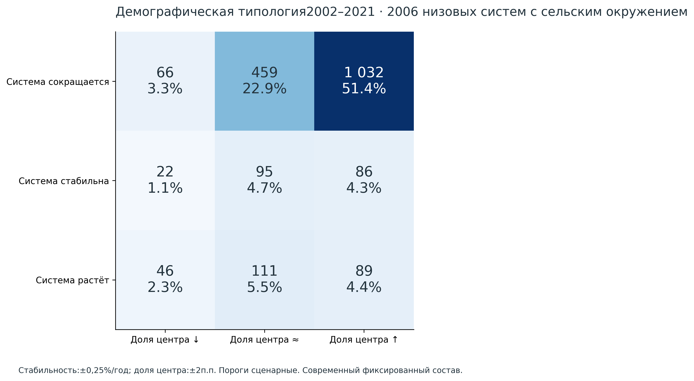

# Динамическая типология сельско-городских районов потенциального тяготения России

Предварительный национальный проход по исходной концепции Word ·21 октября 2026. Материал для обсуждения с научным руководителем.

## Что получено и что уже можно обсуждать

Рассчитана многоуровневая система на фиксированной оси 142 570 населённых пунктов. В основной функциональной спецификации модельное назначение получили 139 287 НП;3283 остались вне радиуса доступных кандидатов. На четырёх ступенях получены 4891,2610,570 и 161 система. Из низовых систем 2006 имеют внешнее сельское окружение и обычный сопоставимый центр; именно они образуют основную демографическую типологию. Это национальный вычислительный результат, но не подтверждённая сеть реального обслуживания.

В 1032 из 2006 сельских систем (51.4%) сокращение общего населения 2002–2021 сочетается с увеличением доли центра. Такое сочетание описывает концентрацию на фоне сжатия. Оно само по себе не устанавливает переезд жителей из окружения в центр.

Ключевой отрицательный результат: основная модель плохо воспроизводит доступные нормативные школьные связи —2 совпадения из 98 датированных утверждений для многопрофильного центра и 0 для отдельного образовательного назначения. Среди 16 известных поставщиков в модельных кандидатах присутствуют лишь 3. Вариант пока нельзя использовать как готовые границы реального обслуживания или основу адресного распределения господдержки. Возможные причины: неполнота сельских функций, различия уровней услуг и дат, расстояние вместо дорожного времени, а также сама спецификация массы.

Дополнительно построена близкая исходной постановке Word демографическая альтернатива: 6094 потенциальных обычных центров, 3520 низовых систем с сельским окружением; уровни 6094 / 3131 / 737 / 211. Крупнейшие поселения муниципалитетов явно помечены provisional; они не объявляются доказанными райцентрами. Альтернатива показывает цену исходных предположений, не заменяет функциональную проверку.

## Три вопроса для обсуждения

Какую функцию и уровень обслуживания принять за основу низового района? Какие массовые физические реестры реально доступны? Как организовать независимую проверку и дорожную доступность до окончательной делимитации?
